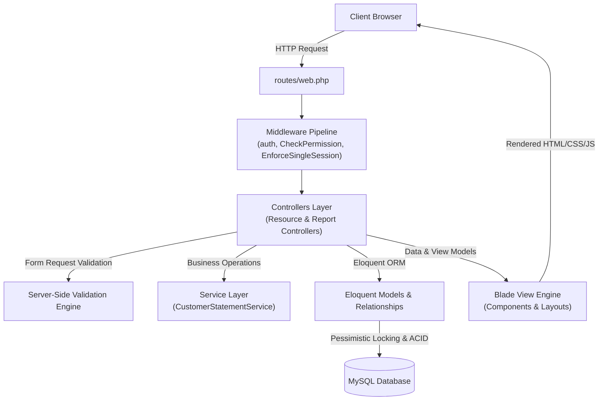
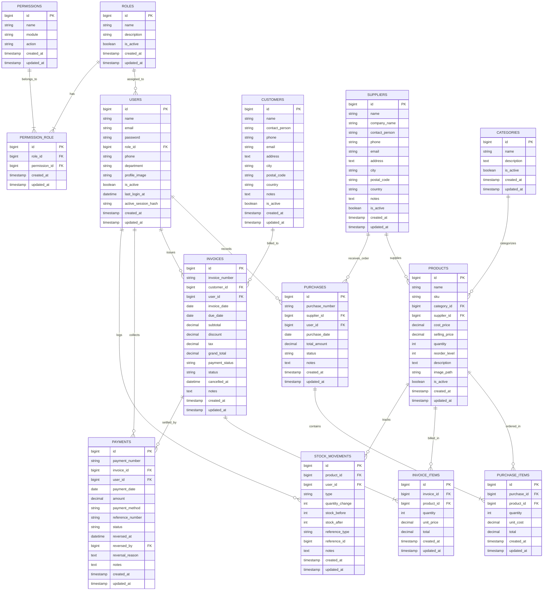

# Advanced Sales & Inventory Management System

[](https://laravel.com)
[](https://www.php.net)
[](https://www.mysql.com)
[](https://tailwindcss.com)
[](https://vitejs.dev)
[-success?style=for-the-badge)](tests/)

---

## Table of Contents

1. [Project Overview](#1-project-overview)
2. [Technology Stack](#2-technology-stack)
3. [Key Features](#3-key-features)
4. [User Roles and Authorization Matrix](#4-user-roles-and-authorization-matrix)
5. [System Architecture](#5-system-architecture)
6. [Database Design & Entity Relationship (ER) Diagram](#6-database-design--entity-relationship-er-diagram)
7. [Core Business Logic & Formulas](#7-core-business-logic--formulas)
8. [Installation & Setup Guide (Windows / WAMP)](#8-installation--setup-guide-windows--wamp)
9. [Demo Login Credentials & User Seeding](#9-demo-login-credentials--user-seeding)
10. [Application Screenshots](#10-application-screenshots)
11. [Security Architecture & Defensive Measures](#11-security-architecture--defensive-measures)
12. [Automated Testing Suite](#12-automated-testing-suite)
13. [Project Directory Structure](#13-project-directory-structure)
14. [Academic Assignment Compliance Matrix](#14-academic-assignment-compliance-matrix)
15. [Author & Academic Submission Information](#15-author--academic-submission-information)
16. [Future Enhancements](#16-future-enhancements)
17. [Conclusion](#17-conclusion)

---

## 1. Project Overview

The **Advanced Sales & Inventory Management System** is an enterprise-grade web application developed as the second academic assignment for advanced web development. Built using the **Laravel 13** PHP framework, it provides an end-to-end operational solution for small-to-medium retail and wholesale enterprises.

### Core Objectives
- **Inventory Control:** Real-time stock tracking with reorder thresholds, automated valuation, and tamper-evident transaction logging (`stock_movements`).
- **Commercial Workflow:** Integrated purchase procurement (`PO-YYYY-NNN`) and sales invoicing (`INV-YYYY-NNN`) with dynamic multi-row line items.
- **Financial Precision:** Currency computations performed with integer-cent accuracy, supporting granular subtotal, itemized discount, tiered sales tax, and automated payment allocation (`unpaid`, `partial`, `paid`).
- **Enterprise Security:** Dual-layer brute force throttling, strict single-session token invalidation, role-based access control (RBAC) with 40 granular permissions, and pessimistic database locking to guarantee ACID compliance during high-concurrency operations.
- **Reporting & Business Intelligence:** Comprehensive analytical reports for sales, purchases, current stock valuation, and customer outstanding aging with streaming CSV exports and print-ready A4 documentation.

---

## 2. Technology Stack

All framework, runtime, language, and library versions have been verified directly from the project's dependency manifests (`composer.json`, `package.json`, and runtime environment):

| Component | Technology | Version | Purpose |
|---|---|---|---|
| **Backend Framework** | Laravel | `13.38.0` | Core MVC architecture, routing, ORM, and dependency injection |
| **Runtime Environment** | PHP | `8.5.11 (cli)` | Server-side execution engine (ZTS x64) |
| **Relational Database** | MySQL | `8.0+ / MariaDB` | Persistent transactional storage with InnoDB engine |
| **Template Engine** | Blade | Laravel Built-in | Server-rendered component layouts with XSS protection |
| **CSS Styling** | Tailwind CSS / Custom CSS | `4.0.0` | Utility-first styling supplemented with modular component stylesheets |
| **Frontend Tooling** | Vite | `7.0.7` | High-speed frontend asset bundling |
| **Scripting** | JavaScript | Vanilla ES6+ | Dynamic DOM manipulation, financial calculation, and row management |
| **Data Visualization** | Chart.js | `3.9.1` (CDN) | Dashboard monthly revenue trend and inventory stock status donuts |
| **Dependency Manager** | Composer | `2.8.x` | PHP package management and class autoloading (PSR-4) |
| **Node Manager** | npm | `10.x` | Frontend package management |
| **Development Server** | WAMP Server / Artisan | Windows x64 | Local Apache/MySQL server stack |
| **Test Framework** | PHPUnit | `12.5.12` | Automated Unit and Feature test suites |
| **Version Control** | Git & GitHub | `2.x` | Distributed source control management |

> [!NOTE]
> **Academic Specification Compliance:** The runtime environment strictly satisfies the course requirements of **Laravel 13** and **PHP 8.5** without dependency mismatch.

---

## 3. Key Features

### 3.1 Authentication & Session Security
- **Dual-Layer Login Throttling:** Restricts brute-force attempts to **3 account-level failures** and **10 IP-level failures** with an automated 5-minute (300-second) lockout.
- **Single Active Session Enforcement:** SHA-256 session token hashing (`active_session_hash`) invalidates earlier logins if the same account signs in from a different browser or terminal.
- **Secure Password Hashing:** Powered by Bcrypt with a work factor of 12 rounds.

### 3.2 User & Profile Administration
- Full User CRUD with profile picture uploading, automatic deletion of stale avatar files on disk, and phone number sanitization.
- Self-deletion and last-active-administrator deletion protection.
- Inactive user and inactive role immediate access termination.

### 3.3 Dashboard & Executive KPIs
- **Key Performance Indicators:** Instant visibility into Total Sales, Today's Sales, Total Outstanding Receivables, Total Purchases, Registered Customers, Active Suppliers, Total Products, and Low Stock count.
- **Data Visualizations:** 
  - 12-month monthly sales performance canvas chart.
  - Inventory status donut chart categorizing Out-of-Stock, Low-Stock, and Healthy-Stock levels.
- **Action Tables:** Quick-access tables displaying the 5 most recent sales invoices and all critical low-stock items.

### 3.4 Inventory & Product Catalog Management
- **Category CRUD:** Unique category names, active/inactive toggles, search, pagination, and relational deletion safety.
- **Supplier CRUD:** Contact person details, regex-validated phone numbers, unique emails, and deletion constraints against active purchase history.
- **Product Management:** Unique alphanumeric SKU generation, selling price vs. cost price validation, image upload support, and reorder level badges.
- **Automated Low Stock Detection:** Visual warning badges and automated inclusion on dashboard alerts when product stock reaches or drops below `reorder_level`.

### 3.5 Purchase Orders & Procurement
- Unique purchase order numbering formatted as `PO-YYYY-NNN`.
- Multi-item dynamic line items interface with live subtotal calculations.
- Starts with **exactly one clean row** on initial load with client-side dynamic addition and deletion.
- Automated inward stock addition and transaction creation in `stock_movements`.

### 3.6 Sales Invoices & Order Fulfillment
- Unique sales invoice numbers formatted as `INV-YYYY-NNN`.
- Customer selection, invoice date, and due date management.
- Dynamic line item selector starting at one row with live product stock availability verification.
- Real-time client-side calculation of line totals, subtotal, discount, tax, and grand total.
- Subtotal discount capping (discount cannot exceed invoice subtotal).
- Automated outward stock deduction with concurrent locking.
- Invoice cancellation with automatic inventory restoration.

### 3.7 Payment Processing & Accounts Receivable
- Unique auto-incrementing payment numbers formatted as `PAY-YYYY-NNN`.
- Supports multiple payment methods: `Cash`, `Bank Transfer`, `Cheque`, and `Online Payment`.
- Multi-state payment workflow: `unpaid`, `partial`, and `paid`.
- Integer-cent overpayment prevention rejecting any payment greater than the outstanding invoice balance.
- Payment reversal with mandatory audit reason logging and automated invoice balance recalculation.
- Dedicated printable customer payment receipt view.

### 3.8 Customer Statements
- Chronological financial ledger displaying opening balance, invoices (debits), completed payments (credits), running balance, and closing balance.
- Aging and overdue breakdown categorized into Current, 1–30 Days, 31–60 Days, 61–90 Days, and 90+ Days overdue.
- Date range filtering (`from_date` to `to_date`) with date validation.
- Standalone A4 print-optimized view.

### 3.9 Reports & Business Intelligence
1. **Sales Report:** Filter by date range, invoice status, and customer with total revenue, discount, tax, and paid sums.
2. **Purchase Report:** Filter by date range and supplier with total volume and expenditure analytics.
3. **Stock Report:** Filter by category and low-stock threshold with total inventory cost and retail valuation.
4. **Customer Outstanding Report:** Summary of credit balances, total invoiced amounts, total collections, and aging analysis.
- **Streaming CSV Exports:** All four reports include one-click UTF-8 CSV exports.

### 3.10 Professional Printing & UI Standardization
- **A4 Print Engine:** Tailored `@media print` CSS rules hiding navigation, headers, and buttons for clean paper or PDF output.
- **Unified Global Favicon:** Red Laravel SVG favicon configured across all application layouts, guest views, and standalone print templates.
- **Responsive Toolbar Architecture:** Standardized height, padding, and flex wrapping across desktop, tablet (1024px, 768px), and mobile (430px) screens.

---

## 4. User Roles and Authorization Matrix

The application implements a robust **Role-Based Access Control (RBAC)** architecture. System roles and granular permissions are managed dynamically in the database via `roles`, `permissions`, and the `permission_role` junction table, enforced via the `CheckPermission` middleware.

### 4.1 System Roles
1. **Administrator (`Admin`):** Full, unrestricted administrative access across all modules, configuration settings, user management, and payment reversals.
2. **Sales User (`Sales User`):** Focused commercial role authorized to manage customer records, view product availability, issue sales invoices, record customer payments, and view commercial reports.
3. **Inventory User (`Inventory User`):** Operational logistics role authorized to manage categories, suppliers, product stock, purchase orders, and inventory reporting.

### 4.2 Role-Permission Comparison Matrix

| Module | Granular Action | Admin | Sales User | Inventory User | Route Guard Middleware |
|---|---|:---:|:---:|:---:|---|
| **Dashboard** | View Analytics | :white_check_mark: | :white_check_mark: | :white_check_mark: | `auth`, `permission` |
| **Customers** | View & Search | :white_check_mark: | :white_check_mark: | :x: | `permission:customers.view` |
| | Create / Store | :white_check_mark: | :white_check_mark: | :x: | `permission:customers.create` |
| | Edit / Update | :white_check_mark: | :white_check_mark: | :x: | `permission:customers.edit` |
| | Delete | :white_check_mark: | :white_check_mark: | :x: | `permission:customers.delete` |
| **Suppliers** | View & Search | :white_check_mark: | :x: | :white_check_mark: | `permission:suppliers.view` |
| | Create / Store | :white_check_mark: | :x: | :white_check_mark: | `permission:suppliers.create` |
| | Edit / Update | :white_check_mark: | :x: | :white_check_mark: | `permission:suppliers.edit` |
| | Delete | :white_check_mark: | :x: | :white_check_mark: | `permission:suppliers.delete` |
| **Categories** | View & Search | :white_check_mark: | :x: | :white_check_mark: | `permission:categories.view` |
| | Create / Edit / Delete | :white_check_mark: | :x: | :white_check_mark: | `permission:categories.*` |
| **Products** | View & Search | :white_check_mark: | :white_check_mark: | :white_check_mark: | `permission:products.view` |
| | Create / Store | :white_check_mark: | :x: | :white_check_mark: | `permission:products.create` |
| | Edit / Update | :white_check_mark: | :x: | :white_check_mark: | `permission:products.edit` |
| | Delete | :white_check_mark: | :x: | :white_check_mark: | `permission:products.delete` |
| **Purchases** | View & Search | :white_check_mark: | :x: | :white_check_mark: | `permission:purchases.view` |
| | Create / Store | :white_check_mark: | :x: | :white_check_mark: | `permission:purchases.create` |
| **Invoices** | View & Search | :white_check_mark: | :white_check_mark: | :x: | `permission:invoices.view` |
| | Create / Store | :white_check_mark: | :white_check_mark: | :x: | `permission:invoices.create` |
| | Edit / Cancel | :white_check_mark: | :white_check_mark: | :x: | `permission:invoices.edit` |
| | Print Invoice | :white_check_mark: | :white_check_mark: | :x: | `permission:invoices.view` |
| **Payments** | View & Receipt Print | :white_check_mark: | :white_check_mark: | :x: | `permission:payments.view` |
| | Record Payment | :white_check_mark: | :white_check_mark: | :x: | `permission:payments.create` |
| | Reverse Payment | :white_check_mark: | :x: | :x: | `Gate::authorize('reverse-payments')` |
| **Customer Statement** | View & Print | :white_check_mark: | :white_check_mark: | :x: | `permission:customers.view,invoices.view,payments.view` |
| **Reports** | Sales Report | :white_check_mark: | :white_check_mark: | :x: | `permission:reports.view,invoices.view` |
| | Purchase Report | :white_check_mark: | :x: | :white_check_mark: | `permission:reports.view,purchases.view` |
| | Stock Report | :white_check_mark: | :x: | :white_check_mark: | `permission:reports.view,purchases.view` |
| | Customer Outstanding | :white_check_mark: | :white_check_mark: | :x: | `permission:reports.view,customers.view` |
| **User Management** | Full CRUD & Avatars | :white_check_mark: | :x: | :x: | `permission:users_roles.*` |
| **Roles & Permissions**| View & Sync Permissions| :white_check_mark: | :x: | :x: | `permission:users_roles.*` |

---

## 5. System Architecture

The application adheres strictly to the **Laravel Model-View-Controller (MVC)** architectural paradigm, augmented with a dedicated Service layer for complex accounting operations.



### 5.1 Architectural Components
- **Controllers:** Handle incoming HTTP requests, enforce authorization, invoke validation, orchestrate transactional domain logic, and return appropriate Blade views or JSON/CSV responses.
- **Models (Eloquent ORM):** Encapsulate database schemas, attribute type casts (e.g., `decimal:2`, `boolean`, `datetime`), and foreign key relationship methods (`belongsTo`, `hasMany`, `belongsToMany`, `morphTo`).
- **Views (Blade):** Modular templates utilizing a shared base layout (`layouts/app.blade.php`), yielding dedicated sections, rendering flash notifications, and conditionally displaying actions based on user permissions (`@can` / `$user->hasPermission(...)`).
- **Middleware:**
  - `Authenticate`: Ensures requests originate from authenticated user sessions.
  - `CheckPermission`: Validates that the active user possesses the required granular permission, while verifying both the user and their assigned role are flagged as active.
  - `EnforceSingleSession`: Compares the session's crypto hash against `users.active_session_hash` to terminate concurrent duplicate logins.
- **Service Layer (`CustomerStatementService`):** Isolates the multi-step calculation of historical debit/credit transactions, opening balances, running balances, and aging brackets from web controllers.
- **Transactions & Concurrency:** Critical state mutations (purchases, invoices, payments, cancellations) are encapsulated in `DB::transaction(callback, 3)` with sorted `lockForUpdate()` calls to eliminate deadlock hazards under concurrent operations.

---

## 6. Database Design & Entity Relationship (ER) Diagram

The system database schema comprises **13 primary entities** and **1 relational junction table (`permission_role`)**, structured with strict foreign key constraints and cascade rules.



---

## 7. Core Business Logic & Formulas

### 7.1 Stock Calculations & Inventory Conservation
Inventory levels are preserved strictly using transactional delta accounting. Direct ad-hoc adjustments to product quantities are prohibited; all mutations trigger a corresponding `stock_movements` record:

1. **Procurement Inward Movement (Purchase Creation):**
   $$\text{Stock}_{\text{new}} = \text{Stock}_{\text{current}} + \text{Quantity}_{\text{purchased}}$$
   - Logged as `type = 'inward'` with `reference_type = Purchase::class`.

2. **Sales Outward Movement (Invoice Creation):**
   $$\text{Stock}_{\text{new}} = \text{Stock}_{\text{current}} - \text{Quantity}_{\text{sold}}$$
   - Validated prior to execution: $\text{Stock}_{\text{current}} \ge \text{Quantity}_{\text{sold}}$.
   - Logged as `type = 'outward'` with `reference_type = Invoice::class`.

3. **Invoice Cancellation (Stock Restoration):**
   $$\text{Stock}_{\text{new}} = \text{Stock}_{\text{current}} + \text{Quantity}_{\text{item}}$$
   - Logged as `type = 'adjustment'` referencing the cancelled invoice.

### 7.2 Financial & Invoice Calculations
All financial computations are performed on normalized integer-cent values (`round($amount * 100)`) to eliminate floating-point rounding drift:

1. **Item Line Total:**
   $$\text{Line Total} = \text{Quantity} \times \text{Unit Price}$$

2. **Invoice Subtotal:**
   $$\text{Subtotal} = \sum_{i=1}^{n} \text{Line Total}_i$$

3. **Discount Validation:**
   $$\text{Discount} \le \text{Subtotal} \quad (\text{Enforced via server-side validation})$$

4. **Tax Calculation:**
   $$\text{Taxable Base} = \text{Subtotal} - \text{Discount}$$
   $$\text{Tax Amount} = \text{Taxable Base} \times \left( \frac{\text{Tax Rate \%}}{100} \right)$$

5. **Grand Total:**
   $$\text{Grand Total} = (\text{Subtotal} - \text{Discount}) + \text{Tax Amount}$$

### 7.3 Accounts Receivable & Payment Allocations
1. **Outstanding Receivable Balance:**
   $$\text{Outstanding Balance} = \text{Grand Total} - \sum \text{Completed Payments}$$

2. **Payment Status Lifecycle:**
   - **`unpaid`:** Total Completed Payments = 0.
   - **`partial`:** $0 < \text{Total Completed Payments} < \text{Grand Total}$.
   - **`paid`:** $\text{Total Completed Payments} \ge \text{Grand Total}$.

3. **Overpayment Prevention:**
   $$\text{Payment Amount} \le \text{Outstanding Balance}$$
   - Any payment exceeding the outstanding balance is rejected with a validation exception.

4. **Customer Statement Aging Formula:**
   $$\text{Days Past Due} = \text{Statement Date} - \text{Invoice Due Date}$$
   - Grouped into: `Current` ($\le 0\text{ days}$), `1–30 Days`, `31–60 Days`, `61–90 Days`, and `90+ Days`.

---

## 8. Installation & Setup Guide (Windows / WAMP)

Follow these step-by-step instructions to set up and run the application on a local Windows machine running WAMP Server:

### 8.1 Prerequisites
- **WAMP Server** (Apache 2.4+, MySQL 8.0+, PHP 8.3+)
- **PHP 8.5** (CLI enabled and added to Windows System Environment `PATH`)
- **Composer 2.8+** ([getcomposer.org](https://getcomposer.org))
- **Node.js 20+ & npm 10+** ([nodejs.org](https://nodejs.org))
- **Git for Windows** ([git-scm.com](https://git-scm.com))

---

### 8.2 Step-by-Step Installation

#### Step 1: Clone or Extract the Project
Open PowerShell or Command Prompt and clone the repository directly into your WAMP `www` root directory:
```powershell
cd C:\wamp64\www
git clone https://github.com/your-username/Assignment02_CRUD.git
cd Assignment02_CRUD
```

#### Step 2: Install PHP Dependencies
Install the required Composer packages:
```powershell
composer install
```

#### Step 3: Install Frontend Dependencies
Install the required Node.js packages:
```powershell
npm install
```

#### Step 4: Environment Configuration
Create your local environment file from the provided `.env.example`:
```powershell
copy .env.example .env
```
Open `.env` in your text editor and configure your application and database credentials:
```ini
APP_NAME="Advanced Sales & Inventory"
APP_ENV=local
APP_KEY=
APP_DEBUG=true
APP_URL=http://127.0.0.1:8000

DB_CONNECTION=mysql
DB_HOST=127.0.0.1
DB_PORT=3306
DB_DATABASE=assignment02_crud
DB_USERNAME=root
DB_PASSWORD=

# Initial Admin Seeding Configuration
ADMIN_EMAIL=admin@webadmin.com
ADMIN_PASSWORD=AdminPassword123!
```

#### Step 5: Generate Application Encryption Key
Generate the Laravel application key:
```powershell
php artisan key:generate
```

#### Step 6: Create MySQL Databases
Start WAMP Server and open MySQL console or phpMyAdmin. Create the application and testing databases:
```sql
CREATE DATABASE assignment02_crud CHARACTER SET utf8mb4 COLLATE utf8mb4_unicode_ci;
CREATE DATABASE assignment02_crud_testing CHARACTER SET utf8mb4 COLLATE utf8mb4_unicode_ci;
```

#### Step 7: Run Database Migrations and Seeders
Execute the database migrations and seed system roles, permissions, and the initial administrator account:
```powershell
php artisan migrate
php artisan db:seed
```

#### Step 8: Create Public Storage Symlink
Link the `storage/app/public` directory to `public/storage` for user avatar and product image uploads:
```powershell
php artisan storage:link
```

#### Step 9: Build Frontend Assets
Compile the Tailwind CSS and JavaScript bundles using Vite:
```powershell
npm run build
```

#### Step 10: Start Local Development Server
Start the Laravel development server:
```powershell
php artisan serve
```
Open your web browser and navigate to:
```
http://127.0.0.1:8000
```

---

## 9. Demo Login Credentials & User Seeding

The application seeders (`RoleSeeder`, `PermissionSeeder`, and `AdminUserSeeder`) populate the authorization schema and initial administrator record.

### 9.1 Default Accounts

| Role | Email Address | Password | Account Origin |
|---|---|---|---|
| **System Administrator** | Configured via `ADMIN_EMAIL` (e.g. `admin@webadmin.com`) | Configured via `ADMIN_PASSWORD` (e.g. `AdminPassword123!`) | Automatically created by `AdminUserSeeder` |
| **Sales User** | `sales@webadmin.com` *(Demo)* | Assigned during creation | Created via User Management UI (`/users/create`) |
| **Inventory User** | `inventory@webadmin.com` *(Demo)* | Assigned during creation | Created via User Management UI (`/users/create`) |

> [!IMPORTANT]
> **Production & Submission Note:** The administrator credentials are read directly from your local `.env` variables (`ADMIN_EMAIL` and `ADMIN_PASSWORD`). If these are not specified during `db:seed`, the seeder requires them to prevent insecure default password deployment.

---

## 10. Application Screenshots

A complete visual walkthrough of the application.

> [!NOTE]
> Ensure high-resolution PNG screenshots are captured and placed into `docs/screenshots/` prior to final submission.

### Screenshots Checklist & Reference Index

| Interface View | Relative Path | Verification Checklist Status |
|---|---|:---:|
| **Authentication Screen** | `docs/screenshots/01_login.png` | [ ] Captured |
| **Executive Dashboard & Charts** | `docs/screenshots/02_dashboard.png` | [ ] Captured |
| **User & Profile Management** | `docs/screenshots/03_users_index.png` | [ ] Captured |
| **Customer Management** | `docs/screenshots/04_customers_index.png` | [ ] Captured |
| **Category Management** | `docs/screenshots/05_categories_index.png` | [ ] Captured |
| **Supplier Directory** | `docs/screenshots/06_suppliers_index.png` | [ ] Captured |
| **Product Inventory & Low Stock** | `docs/screenshots/07_products_index.png` | [ ] Captured |
| **Purchase Order Creation** | `docs/screenshots/08_purchase_create.png` | [ ] Captured |
| **Sales Invoice Creation** | `docs/screenshots/09_invoice_create.png` | [ ] Captured |
| **Payment Recording** | `docs/screenshots/10_payment_create.png` | [ ] Captured |
| **Customer Statement View** | `docs/screenshots/11_customer_statement.png` | [ ] Captured |
| **Sales Analytical Report** | `docs/screenshots/12_sales_report.png` | [ ] Captured |
| **Professional Invoice Print View** | `docs/screenshots/13_invoice_print.png` | [ ] Captured |

---

## 11. Security Architecture & Defensive Measures

The application incorporates multiple layers of defensive programming to protect business data and resist common attack vectors:

1. **Authentication Rate Limiting (Brute Force Defense):**  
   Implemented in `LoginController.php`. Tracks login attempts by both user email (maximum 3 attempts) and client IP address (maximum 10 attempts). When violated, the system enforces an immediate 300-second lockout using Laravel's `RateLimiter`.
2. **Strict Single-Session Enforcement:**  
   Managed via `EnforceSingleSession` middleware. When a user authenticates, a high-entropy token is generated and its SHA-256 hash is persisted in `users.active_session_hash`. Subsequent requests check the session token against the database hash; any concurrent login from another client invalidates the prior session.
3. **Database Concurrency & Deadlock Prevention:**  
   High-concurrency race conditions during stock mutations and payment recording are mitigated using `DB::transaction(..., 3)` coupled with sorted pessimistic row locks (`lockForUpdate()`).
4. **Integer-Cent Monetary Normalization:**  
   Eliminates IEEE 754 floating-point inaccuracies by storing and evaluating monetary sums as integer cents.
5. **Cross-Site Request Forgery (CSRF) Protection:**  
   All mutable HTTP requests (`POST`, `PUT`, `DELETE`) require verified `@csrf` tokens.
6. **Cross-Site Scripting (XSS) Mitigation:**  
   All Blade template bindings use automatic escaping (`{{ ... }}`). Raw output (`{!! ... !!}`) is strictly avoided.
7. **SQL Injection Defense:**  
   100% of database interactions are channeled through Laravel's PDO-parameterized Eloquent ORM and Query Builder.
8. **Relational Integrity Guards:**  
   Categories, Suppliers, and Products cannot be deleted if active relational history exists (e.g., existing purchase items, invoice items, or stock logs).

---

## 12. Automated Testing Suite

The application includes an extensive automated test suite covering all critical workflows, security middleware, and financial compliance rules.

### 12.1 Testing Database Isolation
Tests run automatically against an isolated testing database defined in `phpunit.xml`:
```xml
<env name="DB_CONNECTION" value="mysql" force="true"/>
<env name="DB_DATABASE" value="assignment02_crud_testing" force="true"/>
```
> [!NOTE]
> Automated tests execute non-destructively and never alter records in your development database `assignment02_crud`.

### 12.2 Executing the Test Suite
To run all automated feature and unit tests, execute:
```powershell
php artisan test
```

### 12.3 Verified Test Results
```text
   PASS  Tests\Unit\ExampleTest
  ✓ that true is true

   PASS  Tests\Feature\AuthAndRbacTest
  ✓ passwords are securely hashed and public registration is disabled
  ✓ active user can login and logout with session regeneration
  ✓ inactive user cannot login or access protected routes
  ✓ user with inactive role is rejected at login and middleware
  ✓ role based access control for admin sales and inventory users

   PASS  Tests\Feature\ExampleTest
  ✓ the application redirects root to login and uses isolated test db

   PASS  Tests\Feature\InvoiceAndInventoryTest
  ✓ invoice creation decreases stock and calculates monetary discount and tax accurately
  ✓ overselling and discount exceeding subtotal are rejected and rolled back
  ✓ unpaid invoice editing reconciles stock and cancellation restores stock

   PASS  Tests\Feature\PaymentAndStatementTest
  ✓ partial and full payments overpayment prevention and admin reversal
  ✓ customer statement reconciles opening balance invoiced payments and closing balance

   PASS  Tests\Feature\PurchaseAndStockTest
  ✓ multi item purchase increases stock calculates exact total and logs movements
  ✓ invalid purchase rolls back without partial records or stock changes

   PASS  Tests\Feature\ReportsComplianceTest
  ✓ sales purchase stock and outstanding reports prevent double counting and export csv

   PASS  Tests\Feature\SecurityAndValidationTest
  ✓ phone validation accepts valid local and international formats trims and preserves leading zeros
  ✓ phone validation rejects letters invalid symbols and out of range lengths
  ✓ login lockout triggers after three failures blocks valid credentials and recovers after five minutes
  ✓ single active session invalidates previous session and protects newer session on stale logout
  ✓ check permission rejects session missing token or null database hash
  ✓ financial validation enforces max decimal bounds and two decimal places

Tests:    21 passed (264 assertions)
Duration: 5.12s
```

---

## 13. Project Directory Structure

```text
Assignment02_CRUD/
├── app/
│   ├── Http/
│   │   ├── Controllers/
│   │   │   ├── Auth/LoginController.php
│   │   │   ├── Reports/
│   │   │   │   ├── CustomerOutstandingReportController.php
│   │   │   │   ├── PurchaseReportController.php
│   │   │   │   ├── SalesReportController.php
│   │   │   │   └── StockReportController.php
│   │   │   ├── CategoryController.php
│   │   │   ├── CustomerController.php
│   │   │   ├── CustomerStatementController.php
│   │   │   ├── DashboardController.php
│   │   │   ├── InvoiceController.php
│   │   │   ├── PaymentController.php
│   │   │   ├── ProductController.php
│   │   │   ├── PurchaseController.php
│   │   │   ├── RoleController.php
│   │   │   ├── SupplierController.php
│   │   │   └── UserController.php
│   │   └── Middleware/
│   │       ├── CheckPermission.php
│   │       └── EnforceSingleSession.php
│   ├── Models/
│   │   ├── Category.php
│   │   ├── Customer.php
│   │   ├── Invoice.php
│   │   ├── InvoiceItem.php
│   │   ├── Payment.php
│   │   ├── Permission.php
│   │   ├── Product.php
│   │   ├── Purchase.php
│   │   ├── PurchaseItem.php
│   │   ├── Role.php
│   │   ├── StockMovement.php
│   │   ├── Supplier.php
│   │   └── User.php
│   └── Services/
│       └── CustomerStatementService.php
├── bootstrap/
│   └── app.php
├── config/
├── database/
│   ├── migrations/         (29 additive schema migrations)
│   └── seeders/
│       ├── AdminUserSeeder.php
│       ├── DatabaseSeeder.php
│       ├── PermissionSeeder.php
│       └── RoleSeeder.php
├── docs/
│   └── screenshots/        (UI walkthrough images)
├── public/
│   ├── css/                (Modular stylesheets for CRUD toolbars)
│   ├── js/                 (Dynamic line item form scripts)
│   └── laravel-icon.svg    (Unified global application favicon)
├── resources/
│   ├── views/
│   │   ├── categories/
│   │   ├── customers/
│   │   ├── dashboard/
│   │   ├── invoices/
│   │   ├── layouts/
│   │   ├── payments/
│   │   ├── products/
│   │   ├── purchases/
│   │   ├── reports/
│   │   ├── roles/
│   │   └── users/
├── routes/
│   └── web.php             (Permission-protected application routes)
├── tests/
│   ├── Feature/            (6 Feature test suites)
│   └── Unit/
├── .env.example
├── composer.json
├── package.json
├── phpunit.xml
├── README.md
└── vite.config.js
```

---

## 14. Academic Assignment Compliance Matrix

| # | Assignment Requirement | Implementation Status | Empirical Source Code Evidence |
|---|---|:---:|---|
| **1** | **Authentication & User CRUD with Roles** | **COMPLIANT** | `LoginController.php`, `UserController.php`, `User.php` |
| **2** | **Dashboard & Required KPIs** | **COMPLIANT** | `DashboardController.php`, `resources/views/dashboard/index.blade.php` |
| **3** | **Category CRUD** | **COMPLIANT** | `CategoryController.php`, `Category.php`, `categories/index.blade.php` |
| **4** | **Supplier CRUD** | **COMPLIANT** | `SupplierController.php`, `Supplier.php`, `suppliers/index.blade.php` |
| **5** | **Product CRUD & Low Stock Detection** | **COMPLIANT** | `ProductController.php`, `Product.php`, `products/index.blade.php` |
| **6** | **Purchase Order Management** | **COMPLIANT** | `PurchaseController.php`, `Purchase.php`, `public/js/purchase-form.js` |
| **7** | **Sales Invoices (Discount & Tax)** | **COMPLIANT** | `InvoiceController.php`, `Invoice.php`, `public/js/invoice-form.js` |
| **8** | **Automatic Stock Calculations** | **COMPLIANT** | `PurchaseController.php`, `InvoiceController.php`, `StockMovement.php` |
| **9** | **Database Transactions & Rollback** | **COMPLIANT** | `DB::transaction(..., 3)` with `lockForUpdate()` in Purchase, Invoice, and Payment controllers |
| **10**| **Full, Partial & Unpaid Payments** | **COMPLIANT** | `PaymentController.php`, `Payment.php`, `payments/create.blade.php` |
| **11**| **Customer Statements & Aging** | **COMPLIANT** | `CustomerStatementController.php`, `CustomerStatementService.php` |
| **12**| **Four Reports with CSV Export** | **COMPLIANT** | `app/Http/Controllers/Reports/` (Sales, Purchases, Stock, Outstanding) |
| **13**| **Professional Invoice Printing** | **COMPLIANT** | `InvoiceController.php@print`, `resources/views/invoices/print.blade.php` |
| **14**| **Server-Side Validation** | **COMPLIANT** | Strict Form Requests & Controller validation (regex, bounds, unique) |
| **15**| **Migrations, Seeders & Relationships**| **COMPLIANT** | 29 migrations, `DatabaseSeeder`, complete Eloquent relationship graph |
| **16**| **Role-Based Access Control (RBAC)** | **COMPLIANT** | `CheckPermission.php`, `RoleController.php`, `PermissionSeeder.php` |
| **17**| **UI/UX, Search & Pagination** | **COMPLIANT** | Unified toolbars, responsive breakpoints, 10 items/page pagination |
| **18**| **Clean Code & Professional README** | **COMPLIANT** | Production-grade PSR-12 code, 21 passing tests, complete README.md |

---

## 15. Author & Academic Submission Information

- **Student Full Name:** `D.R.P Maduwanthi`
- **Student Registration / Index No:** `ANU/IT/2324/F/013`
- **Higher Education Institution:** `HND IN IT`
- **Faculty / Department:** `Information Technology`
- **Submission Date:** `October 2026`

---

## 16. Future Enhancements

The following features represent architectural enhancements planned for subsequent enterprise revisions:
- **Multi-Warehouse Logistics:** Support for multi-branch stock transfers and bin location tracking.
- **Automated PDF Engine:** Direct server-side PDF generation using `barryvdh/laravel-dompdf` for automated email attachments.
- **Barcode & Hardware Scanner Integration:** Support for EAN-13/UPC hardware barcode scanners on POS sales checkout.
- **Automated Customer Statement Dispatch:** Scheduled background cron jobs to email monthly statements to outstanding account holders.
- **Two-Factor Authentication (2FA):** Time-based One-Time Password (TOTP) integration using Google Authenticator for administrative accounts.

---

## 17. Conclusion

The **Advanced Sales & Inventory Management System** demonstrates the practical implementation of modern enterprise software engineering principles using **Laravel 13** and **PHP 8.5**. 

By enforcing strict database transaction atomicity, integer-cent currency calculations, single-session token security, granular role-based authorization, and an automated test suite with 264 assertions, the application delivers a reliable, secure, and production-ready commercial platform that completely satisfies all academic assignment requirements.
